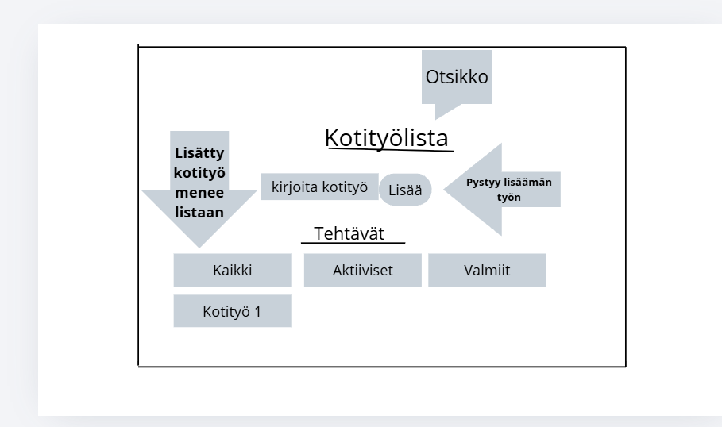
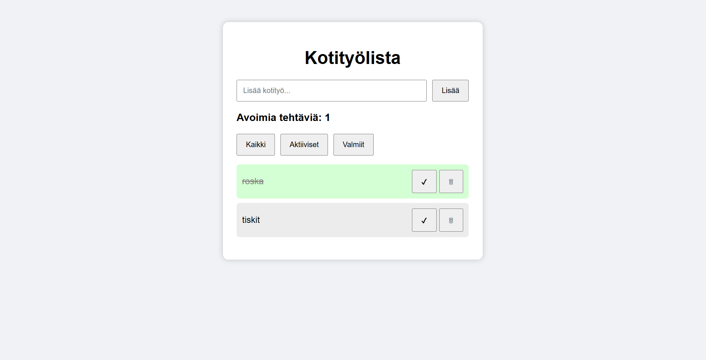

# Projektin nimi

**Tekijä(t):** Henrik Heiskanen / Jani Skogster

## Projektisuunnitelma

### Projektin idea

Kotityö TODO -sovellus on yksinkertainen verkkosovellus, jonka avulla käyttäjä voi lisätä ja seurata omia kotitöitään. 
Sovellus on tarkoitettu henkilöille, jotka haluavat pitää kodin tehtävät järjestyksessä ja seurata, mitkä tehtävät ovat vielä tekemättä.

### Suunnitellut toiminnot

- Toiminto 1: Käyttäjä voi lisätä uusia kotitöitä lomakkeen avulla tehtävälistalle.
- Toiminto 2: Käyttäjä voi merkitä tehtävän tehdyksi tai palauttaa sen aktiiviseksi.
- Toiminto 3: Käyttäjä voi poistaa tehtäviä listalta.
- Toiminto 4: Sovellus tallentaa tehtävät selaimen localStorageen.
- Toiminto 5: Käyttäjä voi suodattaa näkyviin kaikki, aktiiviset tai valmiit tehtävät.

### Rautalankamalli / luonnos

Tässä meidän rautalankamallimme.

## Verkkolinkit

- **Julkaistu sovellus:** [Lisää tähän GitHub Pages -osoite](https://henrikh0.github.io/Projekti_1_DOM_Skriptaus/)
- **GitHub-repositorio:** [Lisää tähän repositorion osoite](https://github.com/HenrikH0/Projekti_1_DOM_Skriptaus)
- **Projektin videoesittely:** [Lisää tähän videon osoite](https://example.com/)

## Tietoja sovelluksesta

**Kotityö TODO -lista** on verkkosovellus, jonka tarkoituksena on auttaa käyttäjää hallitsemaan kodin päivittäisiä tehtäviä.

Sovelluksessa käyttäjä voi lisätä esimerkiksi siivoukseen tai muihin kodin ylläpitotehtäviin liittyviä tehtäviä. Tehtävät voidaan merkitä tehdyiksi tai poistaa listalta. Sovellus tallentaa käyttäjän tehtävät selaimeen, joten tiedot säilyvät myös sivun päivittämisen jälkeen.

## Teknologiat

Projektissa käytettiin seuraavia teknologioita:

- **HTML** – Sivun rakenne ja lomakkeen luominen.
- **CSS** – Sovelluksen ulkoasu, elementtien asettelu ja tyylittely.
- **JavaScript** – Sovelluksen toiminnallisuus, DOM-skriptaus, tapahtumien käsittely ja lomakkeen validointi.
- **localStorage** – Tehtävien tallentaminen selaimen muistiin.

## Sovelluksen käyttö

1. Avaa julkaistu sovellus selaimessa.
2. Kirjoita kotityö tekstikenttään.
3. Paina "Lisää"-painiketta.
4. Uusi tehtävä ilmestyy tehtävälistalle.
5. Merkitse tehtävä tehdyksi painamalla ✔-painiketta.
6. Poista tehtävä painamalla 🗑-painiketta.
7. Käytä suodatusnappeja nähdäksesi kaikki, aktiiviset tai valmiit tehtävät.

## Sovelluksen käynnistäminen paikallisesti

1. Kloonaa tai lataa tämä repositorio omalle koneellesi.
2. Avaa projektikansio.
3. Avaa `index.html` selaimessa.

## Kuvakaappaukset

Toimivasta sovelluksesta kuvakaappaus

## Tunnetut virheet / puutteet

**Ei tunnettuja virheitä.**

## Työn jakautuminen

*Täytä tämä osio vain, jos teit projektin parityönä.*

Kuvaile, miten työ jakautui ja miten yhteistyö sujui.

- Tekijä 1: ...
- Tekijä 2: ...

## Oma arvio ja oppimisen reflektointi

Pohdi työtäsi ja oppimisprosessiasi.

- Missä onnistuin?
- Mikä oli haastavaa?
- Mitä parantaisin, jos aikaa olisi enemmän?
- Mitä opin HTML:stä, CSS:stä, JavaScriptistä ja DOM-skriptauksesta?
- Mikä jäi epäselväksi tai mistä haluaisin oppia lisää?
- Oma arvio projektista: **xx/10 pistettä**

## Lähteet ja kiitokset

Listaa kaikki projektissa käyttämäsi lähteet, tutoriaalit, kuvat ja koodiesimerkit.

Jos käytit ChatGPT:tä, GitHub Copilotia tai muuta tekoälytyökalua, mainitse se tässä ja kerro lyhyesti, miten se tuki työskentelyäsi.

- [Lähteen tai tutoriaalin nimi](https://example.com/)
- [Kuvalähde](https://example.com/)
- Käytetty tekoälytyökalu: ...
- Miten työkalua käytettiin: ...

  ## Lisenssi

Tämä projekti on lisensoitu MIT-lisenssillä.

Lisätietoa lisenssin lisäämisestä GitHub-projektiin:
https://docs.github.com/en/communities/setting-up-your-project-for-healthy-contributions/adding-a-license-to-a-repository